# FormulaCompiler.jl

FormulaCompiler implements a type-stable counterfactual vector system providing variable substitution with O(1) memory overhead without data duplication. This is particularly useful for policy analysis and treatment effect evaluation.

## Key Features

- Memory efficiency: Per-row evaluation with zero allocations
- Computational performance: Improvements over traditional `modelmatrix()` approaches for single-row evaluations  
- Comprehensive compatibility: Supports StatsModels.jl formulas, including complex interactions and the mathematical functions listed under [Supported Functions](@ref)
- Categorical mixtures: Weighted categorical specifications for marginal effects, read from the data at evaluation time
- Scenario analysis: Memory-efficient variable override system for counterfactual analysis
- Unified architecture: Single compilation pipeline accommodates diverse formula structures
- Ecosystem integration: Compatible with GLM.jl, MixedModels.jl, and StandardizedPredictors.jl
- Dual-backend derivatives: Memory-efficient finite differences and ForwardDiff automatic differentiation options (ForwardDiff is the strongly preferred default option)

## Installation

```julia
using Pkg
Pkg.add("FormulaCompiler")
```

## Quick Start



*Figure: Basic FormulaCompiler.jl workflow*

```julia
using FormulaCompiler, GLM, DataFrames, Tables

# Fit your model normally
df = DataFrame(
    y = randn(1000),
    x = randn(1000),
    z = abs.(randn(1000)) .+ 0.1,
    group = categorical(rand(["A", "B", "C"], 1000))
)

model = lm(@formula(y ~ x * group + log(z)), df)

# Compile once for efficient repeated evaluation  
data = Tables.columntable(df)
compiled = compile_formula(model, data)
row_vec = Vector{Float64}(undef, length(compiled))

# Memory-efficient evaluation suitable for repeated calls
compiled(row_vec, data, 1)  # Zero allocations after warmup
```

## Performance Comparison

Performance results across all tested formula types:

```julia
using BenchmarkTools

# Traditional approach (creates full model matrix)
@benchmark modelmatrix(model)[1, :]
# Traditional approach with allocation overhead

# FormulaCompiler (zero-allocation single row)
data = Tables.columntable(df)
compiled = compile_formula(model, data)
row_vec = Vector{Float64}(undef, length(compiled))

@benchmark compiled(row_vec, data, 1)
# FormulaCompiler approach with zero allocations

```

**Zero Allocations** (verified in test suite):
- Core row evaluation (`compiled(row,data,i)`)
- Scenario evaluation (CounterfactualVector)
- FD Jacobian
- AD Jacobian

## Allocation Characteristics

FormulaCompiler.jl provides different allocation guarantees depending on the operation:

### Core Model Evaluation
- Zero allocations: `modelrow!()` and direct `compiled()` calls are 0 bytes after warmup
- Performance: Fast per-row evaluation across all formula complexities
- Validated: Test cases confirm zero-allocation performance

### Derivative Operations
FormulaCompiler.jl provides computational primitives for derivatives with dual backend support:

| Backend | Type | Allocations | Performance | Accuracy | Recommendation |
|---------|------|-------------|-------------|----------|----------------|
| Automatic Differentiation | `ADEvaluator` | 0 bytes | Fast | Machine precision | **Strongly preferred default** |
| Finite Differences | `FDEvaluator` | 0 bytes | Fast | ~1e-8 | - |

```julia
# Build evaluator with automatic differentiation (strongly recommended)
de = derivativeevaluator(:ad, compiled, data, vars)  # Automatic differentiation

# Compute Jacobian with zero allocations
J = Matrix{Float64}(undef, length(compiled), length(vars))
derivative_modelrow!(J, de, row)  # 0 bytes, machine precision

# Marginal effects on η = Xβ from the Jacobian (zero allocations after warmup)
using LinearAlgebra: mul!
g = Vector{Float64}(undef, length(vars))
mul!(g, J', beta)  # g[j] = ∂η/∂vars[j]

# Averaged effects, standard errors, and reporting: use Margins.jl
# population_margins(model, data; type = :effects, vars = vars)
```

## Use Cases

- Monte Carlo simulations with large data and many model evaluations
- Bootstrap resampling: Repeated matrix construction
- Marginal effects: cf. [Margins.jl](https://github.com/emfeltham/Margins.jl) which is built on FormulaCompiler.jl

## Next Steps

- Read the [Getting Started](getting_started.md) guide for a detailed walkthrough
- Explore [Advanced Features](guide/advanced_features.md) for scenario analysis and memory optimization
- Learn about [Categorical Mixtures](guide/categorical_mixtures.md) for marginal effects computation
- See [StandardizedPredictors Integration](integration/standardized_predictors.md) for z-score standardization, centering, and scaling workflows
- Check out [Examples](examples.md) for real-world use cases
- Review the [Mathematical Foundation](mathematical_foundation.md) for comprehensive theory and implementation details
- Review the [API Reference](api.md) for complete function documentation
- Reproduce results with the [Benchmark Protocol](benchmarks.md)

## Citation

```bibtex
@misc{feltham_formulacompilerjl_2026,
  title = {{{FormulaCompiler}}.Jl and {{Margins}}.Jl: {{Efficient Marginal Effects}} in {{Julia}}},
  shorttitle = {{{FormulaCompiler}}.Jl and {{Margins}}.Jl},
  author = {Feltham, Eric},
  year = {2026},
  month = jan,
  number = {arXiv:2601.07065},
  eprint = {2601.07065},
  primaryclass = {stat},
  publisher = {arXiv},
  doi = {10.48550/arXiv.2601.07065},
  archiveprefix = {arXiv},
  keywords = {Statistics - Computation},
}
```
